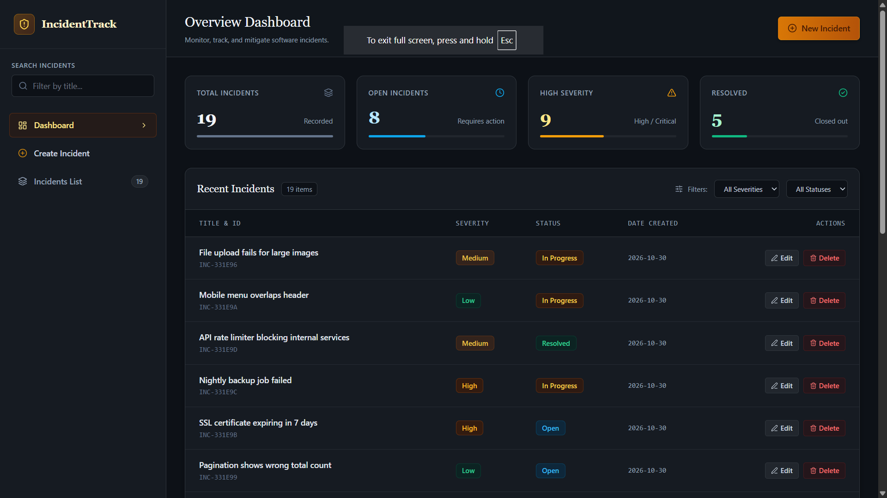
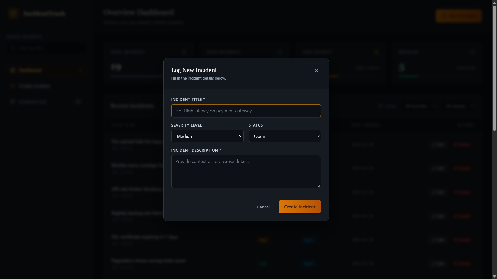
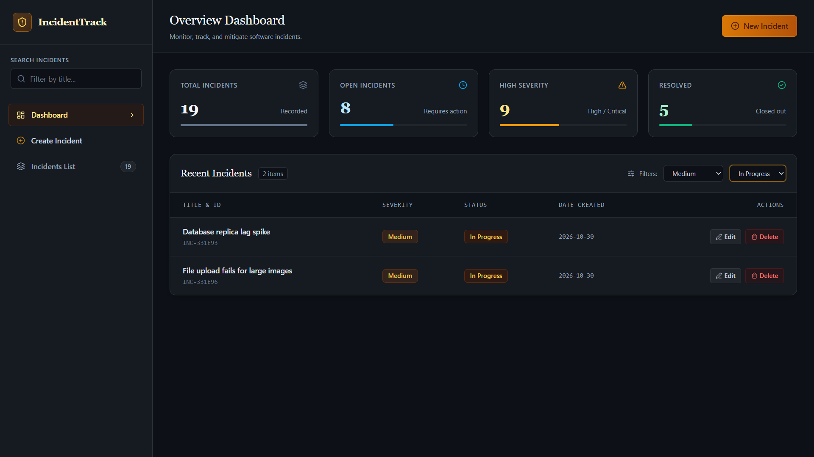

# IncidentTrack

IncidentTrack is a full-stack incident management dashboard designed to log, track, and manage software incidents. It provides a centralised interface to monitor incident severity, track resolution status, and view overall incident statistics.

Built using React, Node.js, Express.js, and MongoDB, the application provides a responsive dashboard backed by REST APIs.

## Dashboard Preview


## Features

- **Dashboard Analytics:** Displays total incidents, open incidents, high-severity incidents, and resolved incidents.
- **Incident Management:** Create, view, update, and delete incidents.
- **Search and Filtering:** Search incidents by title and filter by severity and status through API requests.
- **Severity Classification:** Categorises incidents as Low, Medium, High, or Critical.
- **Status Tracking:** Tracks incidents as Open, In Progress, or Resolved.
- **Modal Forms:** Create and edit incidents using popup forms with validation and error handling.
- **Responsive Dark UI:** Dark-themed interface designed for desktop and mobile screens.

## Screenshots

### Create / Edit Incident


### Search and Filtering



## Tech Stack

| Layer | Technologies |
|---|---|
| Frontend | React, Vite, Axios, Lucide React, CSS |
| Backend | Node.js, Express.js (REST API) |
| Database | MongoDB Atlas, Mongoose |

## Project Structure

```text
IncidentTrack/
│
├── backend/
│   ├── models/
│   │   └── Incident.js       # Incident database schema
│   ├── server.js             # Express server, database connection and API endpoints
│   ├── package.json
│   ├── package-lock.json
│   └── .env                  # Database connection and environment variables
│
├── frontend/
│   ├── index.html
│   ├── package.json
│   └── src/
│       ├── main.jsx          # React entry point
│       ├── App.jsx           # Main application component
│       ├── App.css           # Main page layout
│       │
│       ├── styles/
│       │   └── index.css     # Global styles and shared design tokens
│       │
│       ├── services/
│       │   └── api.js        # Axios instance and API configuration
│       │
│       ├── hooks/
│       │   └── useIncidents.js  # Data fetching, filters and CRUD operations
│       │
│       ├── constants/
│       │   └── incident.js   # Incident statuses, severities and defaults
│       │
│       ├── utils/
│       │   └── incident.js   # Reusable helper functions
│       │
│       └── components/
│           ├── layout/       # Sidebar and Header
│           ├── dashboard/    # DashboardStats and StatCard
│           ├── incidents/    # IncidentTable, IncidentFilters, IncidentFormModal
│           └── common/       # Badge
│
├── screenshots/         
│   ├── dashboard.png
│   ├── create-incident.png
│   └── filtered-view.png
├── .gitignore
└── README.md
```

Each frontend component has its own CSS file alongside its JSX file.

## API Endpoints

**Base URL:** `http://localhost:5000/api`

| Method | Endpoint | Description |
|---|---|---|
| GET | `/incidents` | Retrieve incidents with optional search and filters |
| GET | `/incidents/stats` | Retrieve dashboard statistics |
| GET | `/incidents/:id` | Retrieve a specific incident |
| POST | `/incidents` | Create a new incident |
| PATCH | `/incidents/:id` | Update an existing incident |
| DELETE | `/incidents/:id` | Delete an incident |

### Incident Data Model

| Field | Description |
|---|---|
| `title` | Incident title (required, maximum 100 characters) |
| `description` | Incident description (required, maximum 1000 characters) |
| `severity` | Low, Medium, High, or Critical |
| `status` | Open, In Progress, or Resolved |
| `resolvedAt` | Resolution timestamp, when applicable |
| `createdAt` | Automatically generated creation timestamp |
| `updatedAt` | Automatically generated update timestamp |

## Getting Started

### Prerequisites

- Node.js 18 or newer
- npm
- MongoDB Atlas account or a local MongoDB instance
- Git

### 1. Clone the Repository

```bash
git clone https://github.com/shanmukharani/IncidentTrack.git
cd IncidentTrack
```

### 2. Set Up the Backend

Navigate to the backend directory:

```bash
cd backend
npm install
```

Create a `.env` file inside the `backend` directory:

```env
PORT=5000
MONGO_URI=your_mongodb_connection_string
```

Replace the placeholder with your MongoDB connection string.

Start the backend server:

```bash
npm run dev
```

The backend runs at:

`http://localhost:5000`

### 3. Set Up the Frontend

Open a second terminal at the project root:

```bash
cd frontend
npm install
npm run dev
```

Open the URL provided by Vite, usually:

`http://localhost:5173`

The frontend communicates with the backend through the Axios configuration in `frontend/src/services/api.js`.

## Validation and Error Handling

- Validates required incident fields.
- Restricts severity and status to predefined values.
- Handles invalid incident IDs and missing records.
- Displays form validation and API error messages.
- Provides loading states while retrieving data.

## Future Enhancements

- User authentication using JWT.
- Role-based access for users and administrators.
- Incident assignment to team members.
- Activity history for incident status changes.
- Pagination and sorting.
- Deployment using Render and Vercel.

## Author

**Shanmukha Rani**  
Computer Science and Systems Engineering  
Lendi Institute of Engineering & Technology

---

*IncidentTrack — Simplifying software incident tracking and management.*
